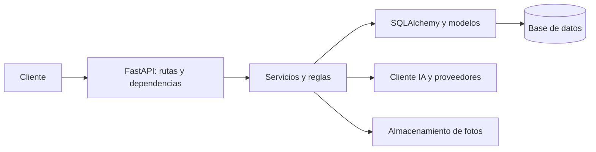
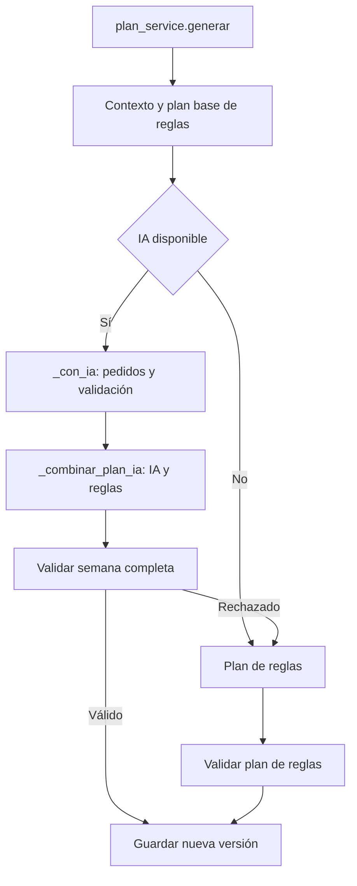

# Arquitectura del backend de Pulse Gym V2

## 1. Propósito y alcance

Este documento describe la organización y los flujos implementados en `backend/app`. El código y las pruebas vigentes son la fuente de verdad; [AGENTS.md](../AGENTS.md) contiene las reglas de trabajo. Los README aportan contexto general y puesta en marcha, aunque sus cifras históricas pueden quedar desactualizadas.

## 2. Vista general

FastAPI expone la API HTTP, Pydantic valida contratos y SQLAlchemy gestiona la persistencia. Las integraciones de IA usan HTTPX; Pillow procesa fotografías que se guardan en el sistema de archivos. La configuración admite SQLite y PostgreSQL. Las pruebas usan pytest y el cliente de pruebas de FastAPI.



## 3. Estructura y responsabilidades

```text
backend/
├── app/
│   ├── main.py          Composición, manejadores y arranque
│   ├── api/             Dependencias y rutas HTTP
│   ├── core/            Configuración, seguridad y utilidades
│   ├── db/              Base ORM, sesiones y carga inicial
│   ├── models/          Entidades y relaciones SQLAlchemy
│   ├── schemas/         Contratos y validaciones Pydantic
│   ├── services/        Casos de uso, reglas e integraciones
│   └── scripts/         Utilidades y carga de catálogo
├── catalogo/            Datos del catálogo
└── tests/               Pruebas backend
```

Las rutas delegan los casos de uso en servicios. `plan_reglas.py` contiene reglas de entrenamiento; `plan_ia.py` prepara e interpreta respuestas de planes; `ia_cliente.py` concentra transporte y coordinación de proveedores. `core/texto.py` comparte la normalización usada por catálogo y reglas.

## 4. Flujo HTTP

`main.py` registra los routers bajo `/api`, CORS y los manejadores de errores. Las rutas declaran entradas y respuestas Pydantic y usan `get_db` y, cuando corresponde, `usuario_actual`. `get_db` abre una sesión SQLAlchemy por petición y la cierra al finalizar. El servicio comprueba reglas y propiedad de datos; las rutas devuelven los esquemas de respuesta.

`ErrorNegocio` se convierte en una respuesta con `detail` y, si existe, `codigo`; los errores de validación usan el manejador de `core/errores_validacion.py`. El backend es la autoridad para validación y autorización.

## 5. Generación de planes



`contexto` reúne perfil, ejercicios permitidos, equipo y lesiones. `_con_ia` pide la explicación general y los días en paralelo mediante `ia_cliente.carrera`; interpreta las respuestas y aplica `plan_reglas.revisar_dia`. Los rechazos de contenido pueden generar nuevas rondas, sujetas a configuración y tiempo disponible. Los motivos concretos se conservan en `pedido.errores_previos` para el reintento; el diagnóstico persistido de rechazo usa una categoría controlada.

`_combinar_plan_ia` conserva el orden del plan base y sustituye los días aceptados. Si no hay días válidos, se recurre a reglas; si solo hay algunos, el resultado puede ser mixto. `generar` valida la semana completa antes de persistirla y también valida el plan construido solo con reglas. Una rutina activa anterior se archiva al guardar la nueva versión.

## 6. Adaptación diaria

`adaptacion_service.hoy` selecciona el día y el gimnasio. `adaptar` comprueba equipo y lesiones mediante `gym_service`, `lesion_service` y `catalogo_service`. Busca una adaptación guardada para usuario, día, fecha y firma de las condiciones; si coincide, reutiliza el resultado.

Para un ejercicio no disponible, el catálogo aporta alternativas permitidas. La IA puede elegir entre las opciones ofrecidas; `_interpretar_elecciones_ia` valida las elecciones, evita opciones ya tomadas y asigna alternativas libres siguiendo el orden existente. Si no hay opción segura, se omite el ejercicio con un aviso. Si la IA falla o no está disponible, se usan las reglas. Si un reemplazo cambia entre multiarticular y no multiarticular, se recalcula la prescripción. La adaptación nueva se guarda con su firma.

## 7. Sesiones, series e historial

`sesion_service.iniciar` toma la sesión adaptada del día y congela sus ejercicios. Registrar una serie crea o corrige el número indicado; el esquema valida peso entre 0 y 500 kg y repeticiones entre 1 y 100. El servicio redondea el peso a incrementos de 0,5 kg y recalcula récords. Borrar una serie también recalcula las marcas.

`_historial` consulta series del ejercicio en sesiones anteriores del usuario. `a_out` incorpora las series de la sesión previa más reciente y la mejor marca. Al finalizar, `_calificar` compara series realizadas y duración con los umbrales configurados para determinar si la sesión es completa o parcial.

`opciones_reemplazo` vuelve a comprobar equipo y lesiones. `reemplazar` cambia solo la sesión actual: si ya hay series, conserva el ejercicio anterior cerrado y añade el reemplazo con las series restantes. Si corresponde registrar una lesión, esta se prepara junto con el reemplazo.

## 8. Fotografías y reconocimiento

`reconocimiento_service.subir` comprueba el gimnasio, llama a `fotos_storage.guardar` y crea el registro de foto. `procesar` valida formato y tamaño, corrige orientación, reduce la imagen y guarda un JPEG sin metadatos EXIF. El servicio verifica la propiedad antes de reconocer, confirmar o descartar una foto.

`ia_vision` interpreta sugerencias frente al catálogo. El usuario confirma una máquina de catálogo para asociarla a la foto; el inventario también permite agregar una máquina manualmente. `fotos_storage` comprueba que las rutas permanezcan dentro del almacenamiento y genera enlaces temporales firmados.

El borrado de una foto individual, un gimnasio o una cuenta confirma primero los cambios SQL y después intenta borrar los archivos físicos. `fotos_storage.borrar` trata archivos inexistentes de forma idempotente y registra categorías controladas para errores de permisos, E/S o rutas rechazadas, sin incluir la ruta ni el texto de la excepción. El procesamiento continúa con los demás archivos.

## 9. Transacciones y responsables

Los servicios coordinan la persistencia; `get_db` administra la vida de la sesión. No existe una regla general según la cual cada función que consulta sea libre de efectos.

| Operación | Comportamiento observado |
| --- | --- |
| Plan | `plan_service.generar` guarda y confirma la rutina y los cambios pendientes de su sesión. |
| Adaptación | `adaptacion_service.adaptar` confirma la adaptación nueva; una reutilizada se devuelve directamente. |
| Uso IA | `ia_uso_service.registrar` añade y hace `flush`; quien lo llama controla el `commit`. |
| Lesión independiente | `lesion_service.crear` llama a `_preparar_creacion`, confirma y refresca. |
| Lesión con reemplazo | `_preparar_creacion` valida consentimiento y hace `flush` sin confirmar. `sesion_service.reemplazar` confirma lesión y reemplazo juntos; ante una excepción en ese bloque hace `rollback` y vuelve a lanzarla. |
| Fotografías | Al subir, si falla el `commit`, `reconocimiento_service.subir` hace `rollback` e intenta borrar el archivo creado. En los borrados se confirma SQL antes de borrar en disco. |

Estos ejemplos no son un inventario de todas las transacciones. El orden y el responsable de confirmación forman parte del comportamiento que debe caracterizarse antes de cambiarlo.

## 10. Cierre automático de sesiones

`_cerrar_olvidadas` busca sesiones en curso del usuario cuyo inicio supera el límite configurado. Las califica usando la fecha de la última serie registrada o, si no hay series, la de inicio; marca `cerrada_auto`. Si encuentra sesiones vencidas, hace `commit`; si no, no confirma.

`en_curso` y `_en_curso_o_error` pueden invocar ese cierre. Por ello, consultar la sesión actual o `/api/hoy`, iniciar una sesión o validar algunas operaciones de una sesión puede escribir y confirmar. Ese `commit` también confirma otros cambios pendientes en la misma sesión SQLAlchemy y puede ocurrir antes de un error de sesión terminada. En el reemplazo con lesión, el cierre se comprueba antes del bloque que confirma juntos la lesión y el ejercicio.

## 11. Errores y uso de IA

`ErrorIA` conserva su mensaje y una categoría interna: `TIMEOUT`, `CONEXION`, `LIMITE_PROVEEDOR`, `RESPUESTA_INVALIDA` o `ERROR_PROVEEDOR`. `ia_uso_service` registra uso, resultado y datos de costo; los flujos de error de reconocimiento, planes y adaptación usan categorías internas controladas. En reconocimiento, `FotoMaquina.ia_ultimo_error` guarda la categoría.

Por decisión del proyecto, se conservan los textos públicos actuales de errores IA. En particular, el error de reconocimiento incluye el texto de `ErrorIA`, que puede incorporar información devuelta por un proveedor. La clasificación interna no garantiza que la respuesta HTTP esté sanitizada. Cambiar los textos o la forma de error requiere una decisión contractual separada.

## 12. Pruebas

`tests/conftest.py` configura una base SQLite temporal, almacenamiento temporal y un proveedor IA simulado antes de importar la aplicación. El fixture de cliente reinicia las tablas para cada prueba que lo usa. Las pruebas de proveedores pueden sustituir respuestas con `monkeypatch`.

Entre las áreas protegidas están reintentos y fallback de planes (`test_plan.py`), adaptación (`test_hoy.py`), series y atomicidad del reemplazo (`test_sesion.py`), almacenamiento y reconocimiento de fotos (`test_fotos.py`), gimnasios (`test_gyms.py`), el cliente IA y la normalización. La existencia de pruebas no implica cobertura exhaustiva ni valida proveedores reales.

## 13. Convenciones y dependencias

Seguir [AGENTS.md](../AGENTS.md): nombres Python convencionales, tipos donde aporten claridad, cambios pequeños y pruebas de comportamiento antes de mover reglas. Las dependencias habituales siguen la dirección ruta → servicio → persistencia o integración. Los esquemas Pydantic describen contratos; los modelos SQLAlchemy representan persistencia.

No añadir repositorios, interfaces o capas por estética. Los servicios pueden coordinar otros servicios cuando el caso de uso lo necesita. Una función que haga `commit`, `flush`, E/S de archivos o llamadas externas debe hacer visible ese efecto y su responsable.

## 14. Decisiones y riesgos conocidos

- **Inicialización:** `main.lifespan` ejecuta `Base.metadata.create_all` y carga el catálogo si corresponde; la carga de datos de demostración depende de configuración. `create_all` crea tablas faltantes, pero no sustituye una estrategia de migraciones para esquemas existentes.
- **SQL y archivos:** no hay atomicidad entre el `commit` SQL y el borrado físico. Un error o interrupción puede dejar archivos huérfanos; el registro de diagnóstico no los recupera ni reintenta su eliminación.
- **Errores públicos IA:** los mensajes actuales se conservan por decisión del proyecto y pueden exponer texto del proveedor. Es un riesgo del contrato actual, distinto de la sanitización del diagnóstico interno.
- **Transacciones en consultas:** el cierre automático puede confirmar cambios pendientes de la sesión SQL, como se describe en la sección 10.
- **Historial:** `sesion_service.a_out` consulta el historial por ejercicio. Esto implica consultas repetidas; no se afirma un problema de rendimiento sin medición.

## 15. Añadir funcionalidades

1. Identificar el contrato HTTP, las reglas existentes y los servicios afectados; validar entradas y propiedad en el backend.
2. Ubicar la coordinación en el servicio correspondiente y mantener los modelos ORM separados de los esquemas de API.
3. Determinar quién confirma la transacción y qué sucede si falla una operación externa o del sistema de archivos.
4. Proteger el comportamiento con pruebas independientes y datos temporales; simular proveedores externos.
5. Preservar contratos y reglas de entrenamiento existentes salvo autorización explícita. Evitar nuevas capas o dependencias sin una necesidad concreta.
